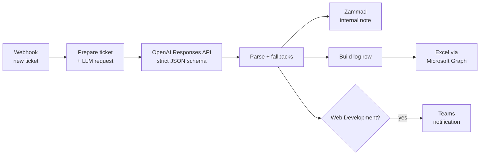

# 01 · LLM ticket triage

Every new helpdesk ticket is classified by an LLM into **team, type and priority**. The workflow writes an **internal note** with a suggested solution and a draft reply for the customer, logs the decision to a spreadsheet and alerts the dev team when the ticket is for them.

**Problem it solved:** tickets arrived in one queue and someone had to read each one to route it. Now agents open a ticket that is already pre-classified and has a draft answer. **The AI suggests and a human decides:** nothing is sent to the customer automatically.

## Flow



## Key design decisions

| Decision | Why |
|---|---|
| **Structured Outputs** (`json_schema`, `strict: true`, `enum` per field) | The model can only return values that exist in the helpdesk dropdowns, so there is no free-text team name to map afterwards |
| **Team definitions with positive and negative examples** ("NOT: …") | Most errors were between neighboring teams (e.g. website emails vs. corporate mailboxes). Writing out the boundaries fixed them better than adding keywords |
| **Confidence score + low-confidence fallback** | Below 60 the ticket goes to the default queue with normal priority instead of trusting a guess |
| **Parse fallback** | If the output cannot be parsed, the workflow still writes a useful note and never breaks the helpdesk webhook |
| **Decision log in a spreadsheet** | Lets the team audit classifications and refine the prompt with real cases |
| **Formula-injection guard** | Text starting with `= + - @` is prefixed so spreadsheets never run it |

## Setup

| Credential / variable | Used by |
|---|---|
| `OpenAI API` credential | Classification request |
| `Zammad API token` (Header Auth: `Authorization: Token token=…`) | Internal note |
| `Microsoft Graph` OAuth2 + `TRIAGE_LOG_DRIVE_ID`, `TRIAGE_LOG_ITEM_ID` | Log table `TriageLogs` |
| `TEAMS_WEBHOOK_URL` | Dev team alert |
| `ZAMMAD_BASE_URL` | Helpdesk API base URL |

In Zammad, a **Trigger** on ticket creation calls the webhook `POST /webhook/ticket-triage`.

## Try it

```bash
curl -X POST http://localhost:5678/webhook-test/ticket-triage \
  -H "Content-Type: application/json" -d @sample-payload.json
```

The [sample ticket](sample-payload.json) should come back as **Web Development · Incident · 3 high**: these are transactional emails sent by the online store, not a corporate mailbox issue.
