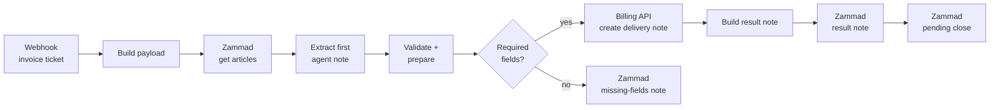

# 02 · Ticket auto-invoicing

When an agent marks a helpdesk ticket as **billable**, this workflow creates the **delivery note** in the billing system, writes the result back to the ticket as an internal note and moves the ticket to *pending close*.

**Problem it solved:** billing for support time was done by hand at the end of the month by copying data from tickets. Some tickets were never billed and descriptions were inconsistent.

## Flow



## Key design decisions

| Decision | Why |
|---|---|
| **Description = first agent note** (sorted by `created_at`, `sender_id = Agent`) | It is the most complete description of the work done. Falls back to the first non-empty article |
| **Explicit validation before calling the billing API** | A missing field produces a clear note on the ticket ("Missing fields: …") instead of a failed execution nobody sees |
| **Every outcome is written back to the ticket** | Agents never need to open n8n to know whether a ticket was billed |
| **Handles both array and split-item responses** | n8n can return the articles array as one item or many items, and the code supports both |

## Setup

| Credential / variable | Used by |
|---|---|
| `Zammad API token` (Header Auth) | Read articles, add notes, change state |
| `ZAMMAD_BASE_URL` | Helpdesk API |
| `BILLING_API_URL` | Billing system endpoint (`POST /delivery-notes`) |

Expected billing API response: `{ "status": "ok", "number": "DN-2026-0042", "url": "https://…" }`

## Try it

```bash
curl -X POST http://localhost:5678/webhook-test/ticket-invoice \
  -H "Content-Type: application/json" -d @sample-payload.json
```
