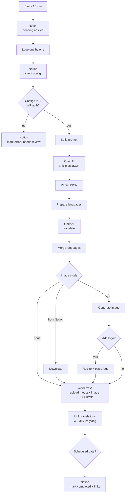

# 03 · AI content pipeline

A **multi-client** blog pipeline. The marketing team writes a brief in Notion (topic, keyword, language, image mode). Every 15 minutes the workflow writes an SEO article with an LLM, translates it, prepares the featured image and creates the posts in the client's **WordPress**, with the language versions linked. It then reports back to Notion.

**Problem it solved:** each article took hours of writing, translating, resizing images and uploading to WordPress, repeated for every client and language. Now the team writes the brief and reviews the draft.

## Flow

## Key design decisions

| Decision | Why |
|---|---|
| **Client config in a Notion database** (WP URL, user, app password, default language, logo, translation plugin) | Adding a new client means adding a Notion row, with no changes to the workflow |
| **Fail fast before spending tokens** | Validates the config and WordPress credentials before calling the LLM |
| **LLM returns JSON** (title, meta description, slug, HTML body) | SEO fields go straight into WordPress and Notion with validation (keyword ≤ 60 chars, valid URL) |
| **3 image modes**: none / from Notion / AI-generated + client logo overlay | Covers clients with their own photos as well as clients without any |
| **WPML and Polylang support** | Posts are created as drafts, linked as translations, then scheduled. The plugins refuse to link posts that are already scheduled |
| **Every error goes back to Notion** (`Error` / `Needs review`) | The marketing team sees what failed without opening n8n |

## Setup

- `Notion API` credential and two databases: **Articles** (`YOUR_ARTICLES_DATABASE_ID`) and **Clients** (`YOUR_CLIENTS_DATABASE_ID`)
- `OpenAI API` credential (text and image models)
- For each client WordPress site: an Application Password stored in the Clients database, plus a small endpoint to link translations (`/wp-json/n8n-wpml/v1/link` or `/wp-json/n8n-polylang/v1/link`)

> The Notion property names and code comments are in Spanish because the pipeline was built for a Spanish-speaking team.
