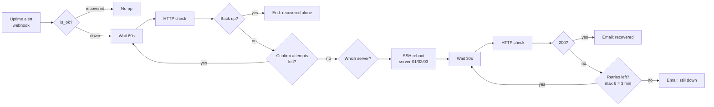

# 04 · Self-healing VPS

When the uptime monitor reports a website as down, the workflow **confirms** the outage, **reboots the right server over SSH**, **checks** that the site is back and emails the team with the result.

**Problem it solved:** some client sites on small VPSs hung from time to time and needed a manual reboot, often out of office hours. Most incidents now fix themselves within minutes, and a human is only called when the reboot does not work.

## Flow

## Key design decisions

| Decision | Why |
|---|---|
| **Confirm before acting** (up to 5 checks, 60s apart) | Avoids rebooting on one-off timeouts or brief network blips |
| **Bounded retry loops** (`$runIndex` counters + max attempts) | The first version could loop forever when a site never came back. Now each loop has a limit |
| **Routing by monitor ID → one SSH credential per server** | One workflow covers all monitored sites. Unknown monitors go to the fallback output and nothing is rebooted |
| **Always notify the outcome** | The team knows if the reboot worked or if they need to step in |

## Setup

- An uptime monitor that sends `monitor_id`, `name`, `target`, `is_ok` to `POST /webhook/uptime-alert` (any tool with webhooks works)
- One `SSH` credential per server, with a user allowed to run `sudo reboot`
- `SMTP` credential for notifications

See [`sample-payload.json`](sample-payload.json).
