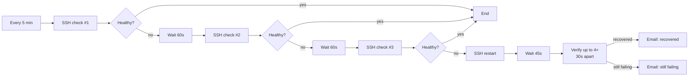

# 05 · Service watchdog

Every 5 minutes it checks over SSH that all **systemd services** of a self-hosted application are running (here, the helpdesk: web, websocket and worker processes). If they keep failing, it restarts them, checks the recovery and notifies the team.

The same pattern runs a second watchdog for the application's **Elasticsearch** (it checks that the search index answers, not only that the process is up).

## Flow

## Key design decisions

| Decision | Why |
|---|---|
| **3 consecutive failed checks before restarting** | A restart has a cost, so it only happens after a sustained failure and not after a brief glitch |
| **The scripts always `exit 0` and print `RESULT=HEALTHY/UNHEALTHY`** | The decision is made in n8n from stdout, so an SSH error is never confused with "service down" |
| **Each service is checked one by one** (`systemctl is-active`) | The alert says *which* service failed |
| **Secrets stay on the server** (the script reads an env file) | The workflow does not contain database or Elasticsearch passwords |

## Setup

- `SSH server` credential with permission to run `systemctl restart <service>`
- `SMTP` credential
- Edit the `SERVICES` list in the SSH nodes to match your application
