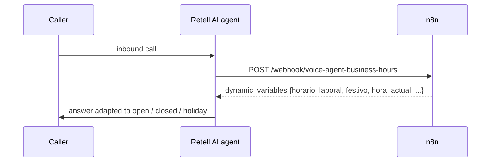

# 06 · Voice agent: business hours & holidays

An AI phone agent ([Retell AI](https://www.retellai.com/)) calls this webhook **at the start of every inbound call**. The workflow returns **dynamic variables** (open or closed, holiday name, local date and time, weekday) that the agent's prompt uses to choose what to say: take the call, or explain the hours and collect a callback request.

**Problem it solved:** LLMs don't know the current time, local holidays or daylight saving time. Without this, the agent could tell a caller the office was open on a public holiday.

## Flow

## Key design decisions

| Decision | Why |
|---|---|
| **`Intl.DateTimeFormat` with `Europe/Madrid`** | Daylight saving time is handled correctly whatever the server's timezone |
| **Fixed holidays + one-off holidays + Good Friday calculated** (Easter algorithm) | Movable holidays need no yearly manual update |
| **Same response works for two Retell features** | Valid both for the *Inbound Call Webhook* (`call_inbound.dynamic_variables`) and as a *Custom Function* (root fields) |
| **Variables in Spanish** | They are referenced directly in a Spanish-language agent prompt |

## Setup

In Retell: **Phone number → Inbound call webhook** → `https://<your-n8n>/webhook/voice-agent-business-hours`.

Example response: [`sample-response.json`](sample-response.json).
