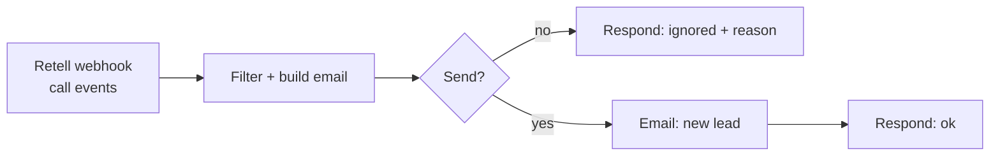

# 07 · Voice agent: lead capture

After every call to the AI phone agent, Retell sends the **post-call analysis** (summary, sentiment, extracted fields, transcript). The workflow **filters out calls with no value** and emails the sales team a formatted **lead card** ranked by interest level.

**Problem it solved:** the voice agent answered after-hours sales calls, but the information stayed in the Retell dashboard. Now every useful call becomes a lead email the next morning, and short calls, voicemails and calls with no data are dropped.

## Flow

**Filters, in order:** event is `call_analyzed` → duration ≥ 45s → not voicemail → at least one useful field (name, contact or reason).

## Key design decisions

| Decision | Why |
|---|---|
| **Structured extraction is configured in Retell** (`custom_analysis_data`: name, company, contact, interest, interest level) | The LLM post-call analysis returns fields with fixed names, so n8n doesn't need to parse free text |
| **Every ignored call returns its skip reason** | Easy to audit why a call did not create a lead |
| **Interest level drives the subject emoji and color** | Sales can prioritize from the inbox without opening each email |
| **Transcript included, formatted by speaker** | Context for the salesperson before calling back |

## Setup

- In Retell: agent **webhook URL** → `https://<your-n8n>/webhook/voice-agent-lead`, plus *Post-call analysis* fields with the names used in the code
- `SMTP` credential

Try it with [`sample-payload.json`](sample-payload.json).
